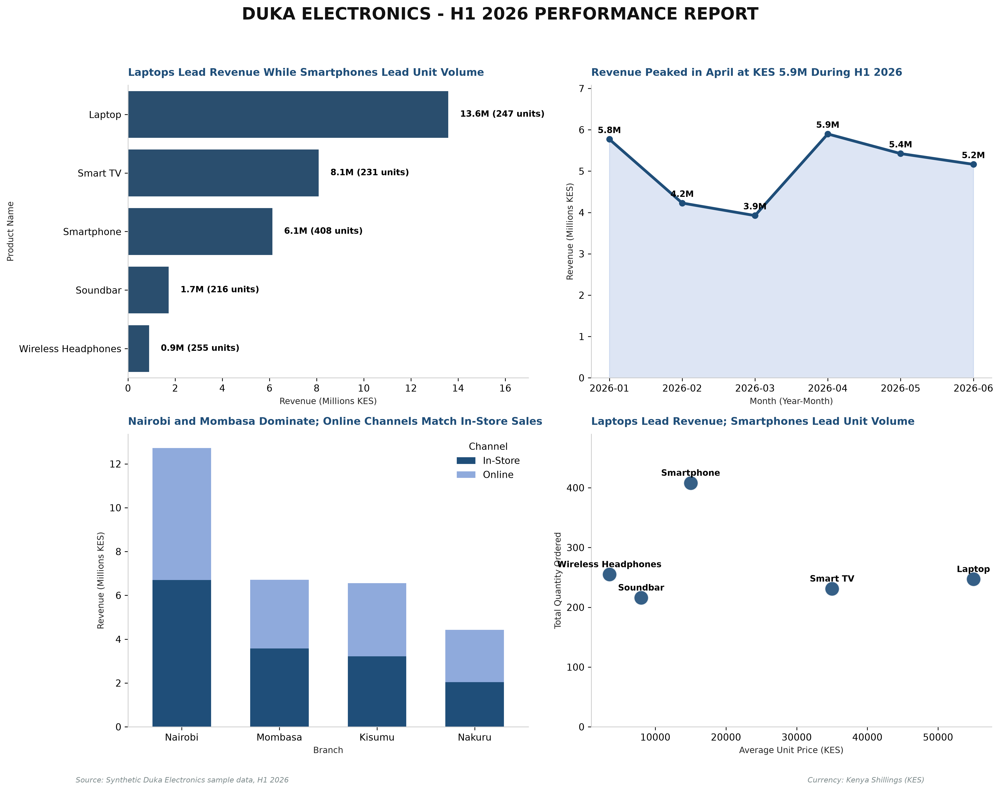

# Student Performance EDA and Duka Board Visual Report

This project contains two data-analysis engagements: a student-performance exploratory data analysis (EDA) and a one-page H1 2026 sales report for Duka Electronics. Both use reproducible, seeded sample data generated locally; the Duka figures are illustrative and are not audited company results.

## Engagements

### Student performance EDA

`student_eda.ipynb` examines a synthetic cohort of 500 learners to help education leaders identify where learner-support resources may be most useful. It checks data structure and quality, summarizes score and attendance distributions, defines performance bands, compares study-hour cohorts, explores correlations, and visualizes score trends. The analysis is descriptive: associations do not demonstrate that attendance or study time caused a score change.

### Duka Electronics board report

`board_report.ipynb` analyzes 1,000 synthetic orders dated in H1 2026. It compares a default and a redesigned branch chart, then assembles product revenue and volume, monthly revenue, branch/channel revenue, and product price/quantity into a single-page board report. Product prices are assigned by product category in the generator so the product-level comparisons are interpretable.

## Setup

Use Python 3.14 or another compatible Python version. From the project directory, install the dependencies and generate both CSV datasets:

```bash
pip install -r requirements.txt
python generate_data.py
```

The generator writes `student_performance.csv` (500 rows) and `duka_sales.csv` (1,000 rows) beside the notebooks. Its fixed random seeds make the sample data reproducible.

To run the notebooks, open this folder in Jupyter or VS Code and select a Python kernel with the listed dependencies. The checked-in notebook outputs were executed with the `Student and Duka Reports (Python 3.14)` kernel (Python 3.14.7). The notebooks create their chart and report output folders when run.

## Five key Student EDA insights

1. **The sample is analysis-ready:** all 500 learner records have complete values and there are no duplicate rows. The mean final score is **69.64**, and the mean of previous and final scores (`average_score`) is **70.46**.
2. **Almost one learner in four is at risk:** using the notebook's bands (`At Risk` < 60, `Meeting` 60–<75, `Exceeding` ≥75), **24.2%** are At Risk, **35.0%** are Meeting, and **40.8%** are Exceeding.
3. **Study time is positively associated with performance, but is not a full explanation:** learners studied an average of **11.06 hours**. Study hours correlate with final score at **r = 0.653**. The highest study-hours quartile averages **75.1** (female) and **74.5** (male) on `average_score`, compared with **64.8** and **64.8** in the lowest quartile.
4. **Attendance has a moderate association with final score:** mean attendance is **80.14%**, and its correlation with final score is **r = 0.421**. Attendance is a useful monitoring signal, not proof of a causal effect.
5. **Prior scores carry useful context:** `previous_score` correlates with `final_score` at **r = 0.485**. Its correlation with `average_score` is **r = 0.917**, as expected because `average_score` is calculated from previous and final scores; this derived measure is not an independent outcome.

## Duka H1 2026 one-page report



The report image is generated by `board_report.ipynb` at `reports/duka_board_report.png`. The product and monthly chart labels show revenue in millions of KES, rounded to one decimal place; their unit counts are shown as whole units.

## Board Summary

During H1 2026, Duka Electronics processed 1,000 synthetic orders worth KES 30.4 million. Nairobi led branches at KES 12.7 million, contributing approximately 42% of revenue; Mombasa recorded KES 6.7 million, Kisumu KES 6.6 million, and Nakuru KES 4.4 million. Laptops generated the highest product revenue at KES 13.6 million from 247 units, followed by Smart TVs at KES 8.1 million from 231 units. Smartphones sold 408 units and generated KES 6.1 million, while Soundbars sold 216 units for KES 1.7 million and Wireless Headphones sold 255 units for KES 0.9 million. Monthly revenue peaked in April at KES 5.9 million and reached its low in March at KES 3.9 million. Online sales totaled KES 14.9 million against KES 15.5 million in-store. Prioritize laptop inventory and Nairobi coverage, reinforce digital conversion, and monitor monthly demand to balance stock. These directional insights reflect seeded synthetic transactions by design, not audited ERP records.

## Project files

- `student_eda.ipynb` — student data-quality checks, EDA, cohort comparisons, and figures.
- `board_report.ipynb` — branch-chart redesign and one-page Duka board report.
- `generate_data.py` — deterministic generator for both sample datasets.
- `requirements.txt` — Python dependencies, including `ipykernel`.
- `figures/` — generated student EDA plots and before/after branch charts.
- `reports/duka_board_report.png` — generated one-page report image.
- `student_performance.csv`, `duka_sales.csv` — generated input datasets.
